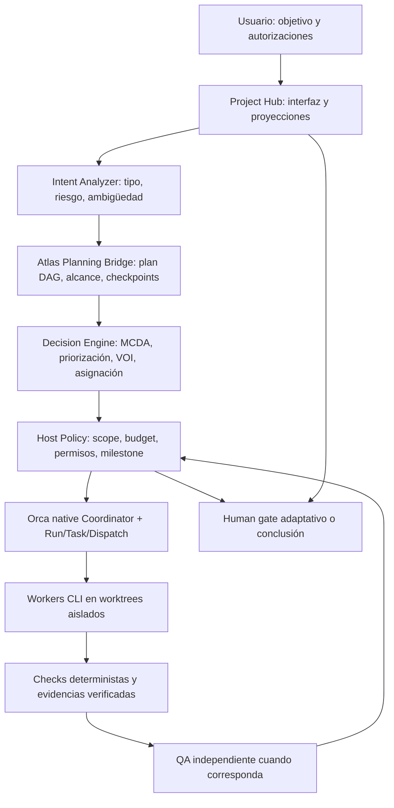

# Orca Adaptive Delivery — arquitectura integral propuesta

> Estado: **propuesta de arquitectura + laboratorio de decisión offline**. No es un runtime integrado, no ejecuta agentes y no cambia autorización de Orca.
> Revisión de código: `bcuyul/orca`, rama `feat/project-hub-agent-intelligence`, PR draft #5, HEAD observado `6b9883d6a4ad3a6d5aa945965e234d705a587538` el 2026-11-02. Actualizar al rebasar.

## Objetivo

Un usuario describe **cualquier escala de trabajo** (microbug, caso de uso, módulo, refactorización, investigación o proyecto completo). Orca interpreta el resultado esperado, propone un plan proporcionado, prioriza tareas factibles, asigna workers autorizados, verifica resultados, repara con límites y se detiene cuando ya hay valor entregable o se necesita una decisión humana material. **MVP es un checkpoint opcional**, no una fase impuesta en toda tarea.

## Estado comprobado en el repositorio revisado

| Sistema | Implementado / alcanzado | Limitación explícita |
| --- | --- | --- |
| Electron renderer/preload/main | UI, APIs y runtime | No implica autonomía integral |
| Git worktrees y terminales | Aislamiento de trabajo y CLI | No supone sandbox de SO |
| `src/main/runtime/orchestration/coordinator.ts` | DAG de tareas precreadas, dispatch, convergencia, mensajes y gates | `decompose()` **no genera tareas**; espera `orchestration.taskCreate` |
| `coordinator-task-dispatch.ts` | Contexto de dispatch y preámbulo, protección ante envío incierto | No reconstruir operación incierta como fallo seguro |
| `db/orchestration-db.ts` | SQLite WAL, migración y métodos nativos | Solo el host debe escribir a esta fuente de verdad |
| `src/main/project-hub/project-hub-store.ts` | Documento por proyecto, CAS de `revision`, políticas append-only | No es transacción conjunta con SQLite |
| `src/shared/project-hub-intelligence.ts` | Plan DAG de 1–20 nodos, blockers, memories, reviews y decisiones declaradas | Plan/QA no ejecutan CLI ni verifican CI automáticamente |
| `ProjectHubDelegationRunner.tsx` | Reserva antes de lanzar CLI y estado `unconfirmed` | `agent.launchReplay` NO equivale a Run/Task/Dispatch ni prueba finalización |
| Backlog EV-01…EV-12 | Dependencias, límites y contratos planificados | Propuestas, no funcionalidades terminadas |

Fuentes de código: enlaces del PR #5 y `docs/project-hub/INTELLIGENCE_FOUNDATION.md`/`INTELLIGENCE_VNEXT_BACKLOG.md`.

## Capas objetivo y responsabilidades



- **Solo Coordinator** decide despacho operativo. No introducir segundo scheduler/DB de grafos.
- **IntentAnalyzer**: heurística inicial por tipo de solicitud, superficie de archivos, riesgo y ambigüedad. Devolver `classification`, `confidenceSource`, `openQuestions`, `riskFlags`, jamás autoridad.
- **PlanningBridge**: Atlas propone un DAG con criterios y hitos. La aprobación del plan no autoriza ejecutar. Validación estricta en host y vinculación `projectId/repoId/hostId/baseSha`.
- **PriorityEngine**: emite alternativas explicables. Si no hay estimaciones confiables, preferir reglas simples; no convertir scores subjetivos en probabilidades reales.
- **ScopeGuard**: protege repositorio, rutas, permisos, historias y operaciones externas. Las políticas no son optimizables.
- **BudgetGuard**: controla nuevas invocaciones, reparaciones, revisiones, concurrencia y tiempo; tokens/dinero solo cuando el CLI informa valores verificables.
- **QualityController**: tests, snapshot por SHA, QA independiente y reparación acotada. No acepta autoafirmaciones del implementador.
- **MilestonePolicy**: determina cuándo presentar resultado parcial, pedir aprobación, continuar o finalizar. El MVP es opcional.
- **EvidenceService**: manifiesto de hashes de código, artefactos, logs, actor de revisión y resultados, sin PII ni secretos por defecto.
- **KevDecisionAdapter opcional**: clasificación de casos ambiguos en `shadow mode` primero; ni desclasifica riesgo ni concede autorización.

## Contratos nuevos, aún no implementados

```ts
// Diseño: no son exports existentes.
type WorkKind = 'microfix'|'use-case'|'module'|'project'|'research';
type DeliveryState = 'planning'|'authorized'|'running'|'verifying'|
  'awaiting_decision'|'completed'|'blocked'|'budget_exhausted';
type MilestoneKind = 'change-review'|'use-case-acceptance'|'module-demo'|
  'mvp'|'v1'|'risk-decision'|'final-review';
type HumanDecision = {
  decisionId: string; deliveryId: string; milestoneId: string;
  planRevision: number; scopeHash: string; evidenceSha: string;
  verdict: 'accept'|'changes_requested'|'stop'; expectedRevision: number;
};
type DispatchAdmission = {
  deliveryId: string; nativeRunId: string; taskId: string;
  authorizedScopeHash: string; expectedBaseSha: string;
  budgetReservationId: string; operationId: string;
};
```

## Autonomía y prioridades

1. Autonomía plena **dentro del alcance autorizado**, sin supeditar cada corrección a una pregunta.
2. Decisiones de negocio ambiguas o materialmente irreversibles => gate humano. Por ejemplo pagos, datos de clientes, ejecución destructiva, cambio de repo, push/merge/deploy.
3. Prioridad se evalúa en tareas **elegibles por DAG y política**, nunca sobre tareas bloqueadas o con autorización pendiente.
4. Ante bloqueos, se registra evidencia y se replanifican tareas afectadas; no se elimina historial ni se relanzan operaciones `unknown`.
5. El éxito de un microbug puede ser un diff y tests; un caso de uso requiere flujo funcional; un módulo requiere contrato de integración; un proyecto puede usar demos, MVP y V1.

## Estructura de ejecución y gate

- **Microfix**: un Run pequeño, verificación proporcional, cierre. No gate MVP.
- **Caso de uso**: plan local acotado, uno o pocos tasks, integración real y aceptación opcional por alto riesgo.
- **Módulo**: DAG de implementación + pruebas, checkpoint de integración.
- **Proyecto**: `DeliverySession` lógica con múltiples Runs nativos. Run MVP si aporta validación temprana, pausa sin **nuevos dispatches**, decisión humana, Run de ampliación/V1 separado; integración humana final.
- `DeliverySession` es una entidad de producto y un registro de checkpoints, **NO un scheduler**.

### Consistencia entre Project Hub y orquestación

Project Hub guarda blueprint y propuestas; OrchestrationDb es la fuente de verdad para Run/Task/Dispatch. El host debe proveer **una operación transaccional de autorización/reserva**, con idempotency key y fencing, en un único ledger transaccional dentro del ámbito nativo. La proyección en Project Hub se reconstruye; no se puede asumir atomicidad simultánea de JSON y SQLite. Si el estado queda `unknown`, no relanzar sin conciliación.

### Presupuestos y pausa

- Antes de iniciar cada trabajo: comprobar autorización + capacidad + reserva de presupuesto. El límite evita **nuevos** despachos; no garantiza detener el costo de un proceso ya activo o un CLI externo.
- Al llegar a `awaiting_decision`, drenar/conciliar procesos, no lanzar nuevos agents. No afirmar que la factura externa está en cero sin comprobar sesiones remotas.
- Alcance y pesos se versionan; una nueva propuesta no altera automáticamente los límites anteriores.

## Amenazas y no objetivos

- Privacidad: no enviar proyectos privados ni secretos a repositorios públicos, memoria compartida, logs de benchmarking, mensajes de PR o servicios de terceros sin autorización.
- Prompt injection: diffs y archivos son datos no confiables; validación y decisiones en el host.
- Concurrencia: no escribir concurrentemente en un worktree; leases e IDs nativos.
- Sin auto merge, push, deploy, PR, Jira o acciones externas en estos incrementos.
- Sin soporte remoto SSH hasta tener operación por host y recibos autoritativos.
- Sin prometer que una evaluación matemática sintética demuestra mejora en usuarios reales.

## Integración incremental

1. Contratos/benchmarks y evaluación de viabilidad (este paquete, sin efecto runtime).
2. Admisión y presupuesto con persistencia/recibos nativos.
3. Atlas plan → Plan/Tasks nativos + autorización.
4. Instrumentación de pruebas, evidencia y QA.
5. Milestones humanos y continuación de Runs.
6. Optimizador y telemetría gradual; Kev opcional bajo benchmark.

Ver también `ADAPTIVE_DELIVERY_MATH_METHODS.md`, `ADAPTIVE_DELIVERY_FEASIBILITY.md`, `ADAPTIVE_DELIVERY_BACKLOG.md` y `ADAPTIVE_DELIVERY_ADR.md`.
