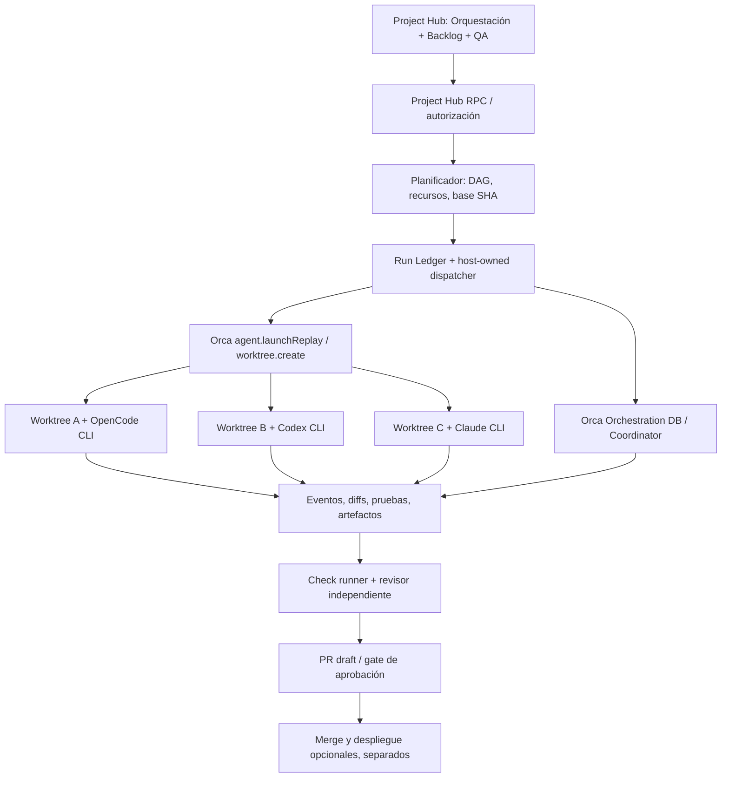

# Project Hub — Roadmap de Orquestación de Agentes CLI

**Estado:** diseño de producto y plan técnico; no representa funcionalidades ya desplegadas.
**Destino:** fork `bcuyul/orca`, dentro del producto Orca Desktop. **PR actual:** [#4](https://github.com/bcuyul/orca/pull/4), apuntando a `feat/project-hub-design-views`.
**Decisión de naming:** pestaña **Orquestación**; módulo **Centro de ejecución**. No presentar “tipo Hermes” como marca del producto.
**Inspiración técnica:** delegación de contexto acotado, subagentes y síntesis de Hermes; transporte, worktrees, CLI y autorización deben ser nativos de Orca.

## 1. Visión

Una persona mantiene un backlog por **Project.id**, elige múltiples historias, revisa un plan de ejecución y aprueba la acción. Orca organiza el trabajo en **worktrees Git independientes**, inicia **OpenCode / Codex / Claude Code / Hermes como CLIs**, recibe evidencias de su trabajo, coordina dependencias, aplica verificaciones CI, asigna una revisión independiente y prepara PRs; nunca declara éxito ni despliega sin evidencias y reglas explícitas.

**Ejemplo de recorrido**:
`Project → backlog → plan DAG → aprobación → run persistente → task → agent CLI → worktree → evidencia → CI → revisión → PR → aprobación humana → merge → despliegue opcional`.

Diferenciar *Project* (identidad y backlog), *Run* (una ejecución de lote), *Task* (historia o subobjetivo), *Attempt* (reintento o asignación concreta), *Agent Session* (CLI vivo), *Worktree* (espacio Git) y *Check* (evidencia). No usar “terminal creada” como sinónimo de “tarea terminada”.

## 2. Inventario fundamentado y brechas

| Disponible en Orca / PR #4 | Brecha |
| --- | --- |
| Project Hub JSON por `Project.id` con guardias de revisión | Identidad canónica de forks y migración de documentos |
| Historia + backlog + QA / fases / aprobación | Historias con dependencias, owner, archivos previstos y ejecución vinculada |
| Plan de lote de 1–10 historias, selector CLI, aprobación y concurrencia 1–3 | Plan multiagente por historia, dependencias y sesiones verificadas |
| `agent.launchReplay` y `create-worktree` nativos | Saga de lanzamiento residente en el host y recuperación de recibos |
| Orca `TuiAgent` incluye `opencode`, `codex`, `claude`, `hermes` | Comprobación de instalación/configuración por host y disponibilidad |
| Orquestador existente `Coordinator`, DB de tareas/despachos, heartbeats y decision gates | Adaptador Hub→orchestration y gestión de ciclo de vida |
| `ProjectHubStore` bloquea transiciones ilegales | Ledger de eventos, proyecciones de ejecución, reintentos y auditoría |
| Unit tests en Windows: 16/16 en corte anterior | E2E Electron, IPC/PTY real, multi-ventana, suspensión y crash recovery |

**Nota de aislamiento:** El proyecto de pruebas mostrado en la UI tenía como rama activa `feat/project-hub-design-views-2`. Actualmente el selector de base está acoplado al worktree activo: riesgo de crear hijos desde un origen incorrecto. El selector de base, el host, el repo y la SHA deben ser parte del plan autorizado.

## 3. Arquitectura objetivo



- **Electron main / runtime** posee despacho, registros durables, IPC/PTY, permisos, logs y estado; **React renderer** solo consulta, planifica y solicita acciones autorizadas. Nunca ejecutar desde JSX mediante strings de shell.
- **Reutilizar** Orca RPC `agent.launchReplay`, `worktree.create`, `Coordinator`, `OrchestrationDb`, `sendAgentTurn`, census de terminales, permisos y capacidades de hosts; no crear una segunda implementación de PTY, worktrees o gestión de credenciales de CLIs.
- **Una sola fuente de verdad por responsabilidad**: Project Hub almacena backlog, políticas, aprobaciones y relaciones; Orca runtime almacena actividad de ejecución y sesiones; Git/CI almacena artefactos verificables. La UI produce una proyección reconciliada.
- Los subagentes de una sesión Hermes, si se utilizan, pertenecen al proceso Hermes; el Hub no debe confundir esas sesiones internas con workers nativos de Orca.

## 4. Roadmap secuencial (orden recomendado por dependencias, no fechas)

### R0 — Consolidar PR #4 y baseline de confianza

**P0 · Antes de lanzar agentes nuevos**

- Cerrar lint, typecheck y pruebas de contratos sobre el último commit; consolidar el test local de persistencia de PH-001 sin sobrescribir archivos sin commit.
- Primera prueba visual: crear una historia ficticia, guardar plan, cerrar/reabrir y verificar misma identidad, repo, host, branch, operationId y revision.
- Verificar negociación real de `agent.launchReplay` (capabilities), `surface:'terminal'`, `prompt.delivery`, ACL del JSON y el comportamiento del handler IPC.
- Test controlado de **un solo OpenCode CLI** en un repositorio de laboratorio; sin push/merge/despliegue.

**Salida:** `planned → launching → launched/unconfirmed` comprobada desde Electron; logs y screenshots de la prueba. Mantener PR como draft hasta cerrar esta puerta.

### R1 — UX coherente y modelo de proyecto/fork

**P0 · Bloquea ejecución multirepo robusta**

- Nomenclatura definitiva: pestaña `Orquestación`, tarjeta `Centro de ejecución`; el antiguo contrato de copiar/pegar fue retirado de la UI para eliminar selectores duplicados. El envío automático actual inicia una **nueva sesión CLI en un nuevo worktree** por historia.
- Panel de detalle de historia: criterios, riesgo, dependencias, agente ejecutor, revisor, ruta/servicio afectado, artifacts, decisiones.
- Distinguir de forma visible **Project.id**, **repo Git (fork real)**, **host**, **worktree activo**, **rama base** y **SHA base**.
- Resolver fallback `github:stablyai/orca` vs fork real `bcuyul/orca` mediante una regla canónica + migración segura; no fusionar dos proyectos ambiguos.
- **Selector de rama base** validado por host, con preflight de commits y cambios locales. Bloquear branch inexistente o base equivocada.

**Salida:** dos forks que compartan upstream nunca ven/ejecutan historias del otro; dos worktrees del mismo Project.id comparten backlog.

### R2 — Saga de lanzamiento durable (host-owned)

**P0 · Reemplaza lógica efímera del renderer**

- Nuevo servicio en Electron main/runtime: `plan → reserve → launch → record → reconcile`; atomicidad por `runId/taskId/attemptId/operationId`.
- Mantener operationId original ante timeouts; nunca producir otro ID sin reconciliar si el launch pudo haber ocurrido.
- Reconciliación de `launching`/ `unconfirmed` frente a ledger de `agent.launchReplay`, sesiones, paneKey, process incarnation y worktree.
- Fallos seguros para shutdown, cierre del panel, host offline, permisos insuficientes, pérdida de respuesta, operación duplicada y aborto parcial.
- Guardar `baseCommitSha`, repoId, hostId, caller identity, policy snapshot y fingerprint inmutable.
- Tabla de estados explícitos: `planned, queued, launching, running, awaiting-review, verified, failed, cancelled, unknown`. Cada transición con motivo y evidencia.

**Salida:** reiniciar Orca durante launch no duplica workers ni pierde una ejecución pendiente; los estados desconocidos no se presentan como éxito.

### R3 — Centro en vivo y observabilidad

**P0 · Ejecución visible y auditable**

- Mostrar run, tarea, CLI/modelo efectivo si el proveedor lo informa, worktree, terminal, últimas actividades, heartbeat, cambios Git y bloqueo.
- Separar `terminal viva`, `prompt entregado`, `trabajo en curso`, `reporte de agente recibido`, `CI pasó` y `aprobado`.
- Suscripciones/eventos del runtime y reconciliación periódica moderada, sin polling masivo de terminales; conservar lo mínimo en el renderer.
- Controles **Abrir sesión**, **Ver diff**, **Solicitar revisión**, **Detener**, **Reintentar con plan autorizado**, **Pausar cola**. No inventar mensajes de “completado”. Añadir enlace opcional a sesiones ya existentes solo cuando se pueda validar su pertenencia al worktree/host, su propiedad y autorización para recibir nuevas tareas.
- Registro JSONL/eventos estructurados y salida terminal acotada/redactada. Si aporta valor, usar Ponytail para tail/seguimiento de logs; no usar logs como fuente de verdad de autorización.

**Salida:** estado fiable tras cerrar/abrir la app; observabilidad de dos workers simultáneos sin mezcla de terminales.

### R4 — Planificador multiagente y grafo de dependencias

**P1 · Paralelismo útil, no solo simultaneidad**

- Traducir historias a tareas nativas del motor de Orca, preservando IDs y enlaces.
- DAG: dependencias `dependsOn`, bloqueos, prioridad, archivos o paquetes afectados; detectar ciclos e incompatibilidades antes del dispatch.
- Diferenciar independientes (paralelas) y encadenadas (secuenciales); no automatizar merges cruzados por compartir archivos.
- Cuotas por host, CLI, perfil y proyecto; límite inicial 2; colas y backpressure. Evitar que el planificador se autoconsuma.
- Preflight: worktree limpio, base actual, permisos del repo, CLI instalado/autenticado, memoria/CPU disponible.

**Salida:** lote de 5 historias con dependencias crea únicamente worktrees válidos y no lanza tareas bloqueadas; límites reales de concurrencia.

### R5 — Coordinador y contexto acotado estilo Hermes

**P1 · Inteligencia de delegación sin duplicar el motor**

- Contrato por historia: objetivo, criterios, archivos permitidos, riesgos, herramientas, presupuesto y formato de respuesta verificable.
- Implementador y **revisor independiente** con contexto limpio; no transmitir el transcript completo ni datos sensibles por defecto.
- Subtareas solamente con autorización/política `maxDepth`; workers leaf sin permiso para spawn, merge, deploy ni cambiar el plan.
- El coordinador agrega resultados y propone correcciones o nuevos trabajos; las decisiones de riesgo alto exigen gate humano.
- Context trimming/síntesis, listas de archivos, diff y referencias, no archivos completos indiscriminadamente.
- Validar respuestas contra un esquema: `summary, changedFiles, checks, risks, blockers, artifacts`. Si faltan pruebas, estado *no verificado*.

**Salida:** una historia se ejecuta, produce un reporte verificable, dispara revisión independiente y conserva evidencia aunque se cierre el agente.

### R6 — Revisión independiente y ciclo de corrección

**P1 · No confundir “agente terminó” con calidad**

- Revisión CLI de otro agente, o humana, en contexto aislado y preferentemente con permisos de solo lectura sobre un diff/snapshot.
- Revisar criterios de aceptación, tipos, cobertura, regresiones, secretos, riesgos de integración y cambios ajenos al alcance.
- Resultado: `approved | changes-requested | blocked | inconclusive` con archivo/rango/evidencia.
- Ciclo de corrección acotado: devolver observaciones al implementador original; versionar intentos; prohibir loops infinitos.
- Aprobar solamente tras comprobaciones verificadas e identidad de revisor distinta de la del implementador.

**Salida:** una regresión intencional es rechazada y devuelta; una revisión sin evidencia no pasa el gate.

### R7 — CI dentro de Orca y PRs trazables

**P1 · CI real**

- Pipeline por repositorio: `format → lint → typecheck → unit → integration → build`; almacenar exit code, stdout/stderr redaccionados, commit SHA y duración.
- Reutilizar scripts reales del proyecto; un `check` que no pudo correr queda `unknown/skipped`, nunca verde.
- Comparación de `merge-base`, detección de cambios concurrentes, base obsoleta, conflictos, archivos sensibles o generados.
- PR draft automático **solo autorizado** y contra remoto/base exactos; vincular PR con Project Hub, worktree, revision, checks y reviewers.
- GitHub Actions / otros CI opcionales como ejecutores de verificación, no condición para usar CLIs locales.
- Política de merge: manual por defecto; jamás push ni merge implícitos por una respuesta de IA.

**Salida:** historia lista → PR draft con diff, reportes de checks y aprobación auditada; PR con CI fallido bloqueado.

### R8 — CD opcional y límites de producción

**P2 · Separado de CI**

- Pipeline de despliegue con entornos `dev/staging/prod`, permisos explícitos y controles externos.
- Nunca desplegar desde el terminal interactivo de un subagente; utilizar runner con identidad y políticas propias.
- Artefacto/imagen inmutable, aprobación para producción, registro de change, healthcheck y rollback.
- Secrets entregados solo al runner autorizado, no a los prompts ni a perfiles de agentes.

**Salida:** un despliegue de staging reproducible; producción siempre requiere una aprobación humana independiente.

### R9 — Seguridad y gobierno

**P0 transversal**

- Seguridad IPC/RPC: autorización por project/repo/host, client capability, ejecución user-scoped y validación de inputs.
- Carga de contenido de historias/documentos como datos no confiables (prompt injection), sin escalar herramientas del subagente.
- Redacción de secretos, paths sensibles y logs; ACL estrictas de userData; no difundir tokens/config de CLI.
- Denegar por defecto `git push`, merge, deploy, acceso a repos ajenos, comandos destructivos y cambios del runtime.
- Retención, auditoría append-only, export y eliminación explícita de artefactos temporales.
- Pruebas adversariales: carreras entre ventanas, replays, host offline, forks homónimos, modificación del plan, falsificación de receipts.

**Salida:** ningún agente puede usar un story/terminal para eludir el repositorio u host autorizados.

### R10 — Escalamiento, perfiles y ergonomía

**P2 · Escalar después de estabilizar**

- Perfiles por tarea: arquitecto, implementador, tester, auditor, documentación y datos; mapeados a CLI y permisos reales.
- Preferencias de modelos y esfuerzo por CLI **sin asumir uso de API**, y visibilidad del uso solo cuando el CLI lo informe.
- Ejecutores Windows/WSL/SSH/remote con capacidades negociadas, sin habilitar un host solo porque el string coincida.
- Backpressure por CPU/RAM/disco/uso; presets 1, 2, 4... sin prometer rendimiento; pruebas de saturación.
- Plantillas reutilizables, prompts versionados, indicadores de lead time, tasa de regresión, costo estimado y deuda de revisión.
- Experiencia accesible en panel ancho, estados legibles, navegación a terminal, historial y filtros.

**Salida:** reproducir el mismo lote en laboratorio local y entorno remoto autorizado con igual trazabilidad y gates.

## 5. Modelo mínimo de datos a evolucionar

```text
Project   { projectId, actualRepoIds[], hostBindings[], policy }
Story     { storyId, projectId, acceptance[], priority, dependencies[], status }
Plan      { planId, projectId, baseRepoId, hostId, baseBranch, baseCommitSha, budget, approvedBy }
Run       { runId, planId, status, createdAt, eventSequence }
Task      { taskId, runId, storyId, dependencies[], scope, assignedAgent, reviewer }
Attempt   { attemptId, taskId, operationId, worktreeId?, handle?, state, lastReceipt? }
Evidence  { taskId, attemptId, commitSha, diffRef?, checkRuns[], reportRef?, reviewRef? }
Decision  { runId, taskId, kind, author, note, policySnapshot, timestamp }
```

Las referencias a `Session` y `Worktree` se resuelven por la identidad nativa del host Orca. No duplicar los procesos en una base propia. Conservar `operationId` de launch y `expectedRevision` del documento para impedir duplicaciones y lost updates.

## 6. Matriz de validación de aceptación

| Caso | Prueba | Resultado exigido |
| --- | --- | --- |
| A01 | 1 historia + OpenCode CLI | Se crea exactamente un worktree/terminal y se guarda el mismo operationId |
| A02 | 2 historias independientes | Dos CLIs en dos worktrees; sin compartir cambios locales |
| A03 | Base branch inexistente | Rechazo antes de crear un worktree |
| A04 | Dos forks con mismo upstream | Backlogs y lanzamientos no se cruzan |
| A05 | Cierre de panel después de la reserva | La saga se reconcilia sin re-spawn |
| A06 | Crash de Electron en launch | No reintento ciego; resultado reconocido o unknown visible |
| A07 | Dos ventanas intentando la misma story | Una reserva; segunda rechazada por revision/ledger |
| A08 | CLI no instalado / no autenticado | Error explícito y no fallback a otro CLI |
| A09 | Reviewer independiente | Reporte distinto, readonly/snapshot, defectos detectados |
| A10 | Tests rojos | Gate bloqueado aunque agente diga “finished” |
| A11 | Secretos en logs/prompt | Redacción y permisos verificados |
| A12 | Host remoto | No crea localmente si el host solicitado no está disponible |
| A13 | 5 historias, DAG con un ciclo | Planificador rechaza ciclo sin side effects |
| A14 | Merge-base obsoleto | Revisión/CI se invalida o re-ejecuta antes de PR |
| A15 | Revisor pide cambios | Corrección acotada en su worktree, sin merge prematuro |
| A16 | Política de producción | No despliega nunca sin autorización independiente |

## 7. Reglas de UX / naming

- **Project Hub** = espacio global de producto.
- **Orquestación** = pestaña.
- **Centro de ejecución** = módulo principal.
- **Plan de ejecución** = selección autorizable.
- **Agentes** = CLIs, no modelos. Mostrar nombre real del CLI y modo de sesión si se conoce.
- **Ejecuciones** = runs históricos. **Actividad** = eventos. **Revisión** = QA. **Integración** = checks + PR.
- "Hermes" solo como agente seleccionable si está instalado, o como referencia de diseño documental. No escribir “tipo Hermes” en la UI.
- No repetir los selectores del contrato manual en el Centro; relegar handoff manual a un panel legado expandible durante migración.

## 8. Orden recomendado de PRs

| Orden | Pull request de trabajo (nombre ilustrativo) | Gate de aceptación |
| --- | --- | --- |
| #4 actual | `feat/project-hub-hermes-delegation` | Uno OpenCode desde una historia + tests + lint + typecheck |
| 5 | Identity, fork, base-branch UX | A03, A04 |
| 6 | Main-owned launch saga and reconciliation | A05, A06, A07, A08 |
| 7 | Live execution console / evidence | A01, A02 y estado observable |
| 8 | DAG scheduler + native orchestration adapter | A13 y concurrencia |
| 9 | Reviewer workers + signed evidence | A09, A10, A15 |
| 10 | Check runner + PR draft gate | A10, A14 |
| 11 | Hardening: remote hosts, security, recovery | A11, A12, regresiones |
| 12 | Optional CD and production controls | A16 |

Los números anteriores son **orden tentativo**; no reservas ni PRs creados. Las funciones de seguridad de R9 son trabajo transversal en cada PR, no una fase que pueda posponerse hasta el final.

## 9. Decisiones que deben permanecer fijas

1. CLIs existentes como proveedores de ejecución; el cliente no pide API keys de OpenCode/Codex/Claude/Hermes para lanzar sus CLIs.
2. Solo host nativo de Orca crea/detiene procesos, controla permisos y escribe el ledger de ejecución.
3. Cada worker dispone de su propio worktree y contexto. Coordinar **no** equivale a mezclar ramas.
4. Human-in-the-loop para lanzamientos con side effects, merges y producción.
5. Entrega de prompt, terminación de proceso, passing checks y aprobación son eventos distintos.
6. Desconocido ≠ fallado y desconocido ≠ exitoso; reconciliar antes de repetir.
7. Capacidad limitada por recursos, no solo por una cifra mostrada en un select.
8. No despliegues de manera implícita. Un PR de trabajo no es autorización para integrar.

## 10. Referencias

- Hermes Agent: [Subagent Delegation](https://hermes-agent.nousresearch.com/docs/user-guide/features/delegation)
- Hermes Agent: [Delegation & Parallel Work](https://hermes-agent.nousresearch.com/docs/guides/delegation-patterns)
- Orca host: `src/main/runtime/rpc/methods/agent-launch.ts`, `src/main/runtime/rpc/methods/agent-launch-worktree-creation.ts`
- Orca orchestration: `src/main/runtime/orchestration/coordinator.ts`, `coordinator-task-dispatch.ts`, `db.ts`
- Hub current: `src/renderer/src/components/right-sidebar/ProjectHubDelegationRunner.tsx`, `src/main/project-hub/project-hub-store.ts`, `src/shared/project-hub-delegation.ts`
